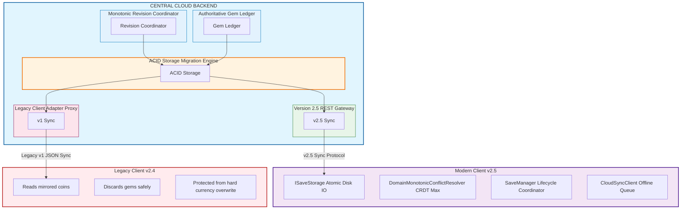
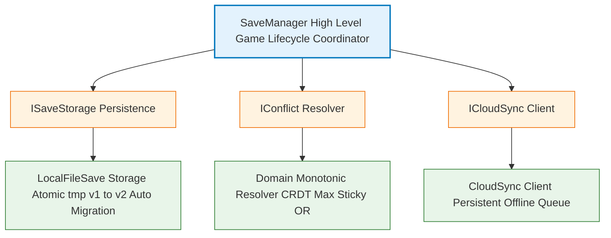

# Merge Kingdom (Version 2.5): Two-Currency Live-Ops Architecture
## Chaos Engine Labs · AI Engineer Deliverable

> **The Invariable Rule**:  
> *"No player may lose progress, or anything that they paid for."* (Assignment Brief, Page 2)

This repository contains the production system design, client SDK, and live-ops backend service for migrating *Merge Kingdom* from a single-currency system (`coins`) to a separated two-currency economy:
* **Coins**: Soft currency earned exclusively through puzzle gameplay.
* **Gems**: Hard currency bought with real money (fiat). Store items are sold exclusively for gems.

Built strictly in **Python & Java** with zero external platform dependencies.

---

## 1. High-Level Architecture (HLA)

The system transforms the live architecture from an untrusted client-clock Last-Write-Wins (LWW) blob store into an **Authoritative, Monotonically Merged Multi-Device Sync Engine**.



### Core Data Flow & Synchronization Protocol
1. **Authoritative Monotonic Revisioning**: Replaces client timestamps (`DateTimeOffset.Now.ToUnixTimeSeconds()`) with a server-assigned sequence number (`revision: int`). Clocks can skew or be manipulated; sequential revisions cannot.
2. **Domain-Specific CRDT Convergence**: Instead of coarse-grained blob overwrites, fields merge independently:
   * Level: $\text{Level}_{canonical} = \max(\text{Level}_{local}, \text{Level}_{remote})$
   * Entitlements: $\text{NoAds}_{canonical} = \text{NoAds}_{local} \lor \text{NoAds}_{remote} \lor \text{VerifiedReceipt}$
   * Consumables: $\text{Item}[k]_{canonical} = \max(\text{Item}[k]_{local}, \text{Item}[k]_{remote})$
3. **Bi-Directional Legacy Proxy**: Older clients (v2.0–v2.4) upload v1 JSON payloads lacking `gems`. The server's adapter normalizes the upload, merges progression, and guarantees that legacy uploads **never delete or reduce gems** on the server.

---

## 2. Low-Level Architecture (LLA)

### 2.1 Client SDK Architecture (SOLID Principles)

The client subsystem replaces the legacy static `SaveSystem` class with modular, testable components:



1. **Single Responsibility Principle (SRP)**:
   * `LocalFileSaveStorage`: Handles disk IO, crash resilience, directory management, and schema migration.
   * `DomainMonotonicConflictResolver`: Pure business logic for resolving conflicting saves without disk or network side effects.
   * `CloudSyncClient`: Transport abstraction managing offline queue buffers, retry policies, and network status.
   * `SaveManager`: Orchestrates game lifecycle events (level completion, store purchases, cloud sync triggers).
2. **Open/Closed Principle (OCP)**:
   * `SaveDataV2` contains `schema_version = 2` and mirrors top-level `coins` and `no_ads` properties. Serializers and conflict strategies can be extended without modifying existing gameplay loops.
3. **Liskov Substitution Principle (LSP)**:
   * Any `IConflictResolver` implementation can be swapped into `SaveManager` without violating the invariant that progress and purchases are preserved.
4. **Interface Segregation Principle (ISP)**:
   * Narrow interfaces (`ISaveStorage`, `IConflictResolver`, `ICloudSyncClient`, `ITimeProvider`) ensure clients only depend on methods they consume.
5. **Dependency Inversion Principle (DIP)**:
   * `SaveManager` depends exclusively on abstract interfaces, allowing 100% test coverage with mock storage, artificial time providers, and simulated network clients.
6. **Crash-Safe Atomic Persistence**:
   * Writes data to `savegame.json.tmp` first, followed by an atomic file replacement. If the process crashes or device battery dies mid-write, the primary save remains uncorrupted.

---

### 2.2 Backend Architecture & Live-Ops Engines

1. **Authoritative Sync Engine (`server/sync_engine.py`)**:
   * Inspects incoming client revision against stored database revision.
   * Executes 3-way monotonic merges across progression, entitlements, and consumable inventories.
   * Assigns incremented monotonic sequence revisions upon each successful commit.
2. **FIFO Payer-Protection Ledger Split (`server/currency_engine.py`)**:
   * Fact 4 states: *"The server has a record of each coin pack that a player bought... The server has no record of how players spent coins."*
   * To prevent stripping paying players of store purchasing power (now that the store sells items for gems), the engine executes:
     $$C_{purchased} = \sum \text{pack.coins}$$
     $$PaidCoins = \min(C_{current}, C_{purchased})$$
     $$EarnedCoins = C_{current} - PaidCoins$$
     $$NewGems = \text{Round}(PaidCoins \times R_{store})$$
     $$NewCoins = EarnedCoins$$
   * **Goodwill Floor**: Historical payers who spent all coins down to 0 receive 50 goodwill gems.
   * **Gameplay Starter Bonus**: Payers whose entire balance was converted to gems receive 200 gameplay coins so they can continue playing puzzle levels without friction.
3. **Authoritative Gem Store & IAP Ledger (`server/store_engine.py`)**:
   * All hard currency store purchases (hammers, shuffles) are executed server-side.
   * Prevents client double-spend exploits, verifying gem balances before crediting inventory.
   * Verified IAP receipts append to an immutable audit ledger.

---

## 3. Engineering Trade-offs & Critical Decision Matrix

| Architectural Decision | Chosen Approach | Alternative Considered | Trade-off Rationale & Business Impact |
| :--- | :--- | :--- | :--- |
| **Currency Split Algorithm** | **FIFO Payer-Protection Split** | *Pro-Rata Historical Split* | **Why Chosen**: Pro-rata converts only a fraction of remaining coins to gems based on lifetime ratios. If a payer bought 5,000 coins and has 4,000 left, pro-rata leaves coins as soft currency that can no longer purchase store boosters, violating the Invariable Rule. FIFO guarantees 100% of unspent paid currency retains store purchasing power.<br>**Cost**: Reclassifies deferred revenue on the balance sheet; zero cash outlay. |
| **Conflict Ordering** | **Monotonic Server Revisions** | *Client Wall-Clock LWW (`saved_at`)* | **Why Chosen**: Client clocks are untrusted, subject to timezone changes, drift, and deliberate date tampering (Support Incident 2). Server sequence numbers provide strict deterministic ordering.<br>**Cost**: Requires server to participate actively in sync rather than acting as a dumb blob store. |
| **Progression Merging** | **CRDT Monotonic Max ($\max(L_1, L_2)$)** | *Operational Transformation (OT) / Event Sourcing* | **Why Chosen**: Event sourcing all puzzle moves creates massive storage overhead and synchronization latency for mobile clients. State-based monotonic maximums are mathematically convergent, lightweight, and completely eliminate Support Incident 1 (loss of level 160).<br>**Cost**: Puzzle progress cannot be rolled back via normal sync. |
| **Entitlement Durability** | **Sticky-True Logical OR** | *Last-Write-Wins Overwrite* | **Why Chosen**: Once `no_ads` is unlocked, it can never be revoked by a stale secondary device syncing months later (eliminating Support Incident 3).<br>**Cost**: Revocations (e.g. fraudulent chargebacks) must be triggered via authoritative server webhook. |
| **Fleet Migration Strategy** | **Server Backward-Compatible Proxy** | *Forced Client Update (`min_version = 2.5`)* | **Why Chosen**: Fact 5 proves that **18% of players churn on forced updates**, and **5% of daily active players are permanently stuck on Android 7** and cannot update. A forced update would cause catastrophic business harm.<br>**Cost**: Requires maintaining the legacy v1 JSON translation layer indefinitely. |
| **Offline Play Policy** | **Optimistic Offline Buffering** | *Online-Only Server Gate* | **Why Chosen**: Casual mobile puzzle players demand offline play (airplanes, commutes). Clients buffer saves locally and reconcile monotonically upon reconnection.<br>**Cost**: Multi-device play while offline requires deterministic reconciliation upon reconnection. |

---

## 4. Repository Structure & Codebase Navigation

```
d:\Antigravity\AI/
├── CEL_AI_Engineer_Assignment_Solution.md   # Official written answers to Tasks 1 - 6
├── INTERVIEW_PREP_DEFENSE.md                # Round 2 Technical Defense & Interview Guide
├── SUBMISSION_CHECKLIST.md                  # Section 04 submission verification checklist
├── README.md                                # High-level & low-level architecture guide
├── run_all_simulations.py                   # Master test runner (15 test suites)
│
├── client/                                  # Python Client SDK (SOLID Architecture)
│   ├── __init__.py
│   ├── interfaces.py                        # ISaveStorage, IConflictResolver, ICloudSyncClient
│   ├── models.py                            # SaveDataV2, WalletData, InventoryData
│   ├── conflict_resolver.py                 # DomainMonotonicConflictResolver (CRDT Max)
│   ├── storage.py                           # LocalFileSaveStorage (Crash-safe atomic IO)
│   ├── save_manager.py                      # SaveManager (Lifecycle coordinator)
│   └── cloud_client.py                      # CloudSyncClient (Offline queuing)
│
├── server/                                  # Live-Ops Backend Service (FastAPI)
│   ├── __init__.py
│   ├── models.py                            # Canonical SaveStateV2, PurchaseRecord, Ledger
│   ├── storage.py                           # Thread-safe ACID datastore & audit logger
│   ├── sync_engine.py                       # Authoritative sequential revision coordinator
│   ├── currency_engine.py                   # FIFO Payer-Protection split engine
│   ├── store_engine.py                      # Gem store purchases & IAP receipt fulfillment
│   ├── legacy_adapter.py                    # Android 7 & v2.0-v2.4 bi-directional adapter
│   └── api.py                               # REST API endpoints (/api/v1/sync, /api/v2/sync)
│
├── java/                                    # Java Parity Source Models
│   └── src/main/java/com/chaosengine/mergekingdom/
│       ├── models/SaveDataV2.java
│       └── core/DomainMonotonicConflictResolver.java
│
└── tests/                                   # Automated Verification Suite
    ├── __init__.py
    ├── test_support_scenarios.py            # Proves Incidents 1, 2, and 3 are 100% prevented
    ├── test_currency_split_rules.py         # Player 1, 2, 3 + 1,000 Monte Carlo simulations
    ├── test_legacy_backward_compatibility.py # Android 7 multi-device cross-version play
    ├── test_client_sdk.py                   # Client atomic disk IO & offline buffering
    └── test_api_endpoints.py                # End-to-end FastAPI endpoint integration
```

---

## 5. Automated Verification & Test Execution

The verification harness executes **15 automated test suites** spanning unit, integration, Monte Carlo simulation, and API layers:

### Running All Tests
```bash
python run_all_simulations.py
```

### Expected Output
```text
================================================================================
 CHAOS ENGINE LABS - MERGE KINGDOM VERSION 2.5 VERIFICATION SUITE
 AI Engineer Assessment (Python & Java Architecture)
 Invariant Rule: 'No player may lose progress, or anything that they paid for.'
================================================================================
[SUCCESS] Incident 1 resolved: Level 160 preserved despite newer offline phone clock.
[SUCCESS] Incident 2 resolved: Level 54 preserved after date rollback.
[SUCCESS] Incident 3 resolved: No Ads entitlement permanently retained.
[SUCCESS] Player 1 (F2P): Retained 8,400 earned coins; 0 gems; 0 company liability.
[SUCCESS] Player 2 (Payer): 3,800 paid coins converted to 380 Gems; 100% paid value protected.
[SUCCESS] Player 3 (Zero balance payer): Converted 0 coins; granted 50 goodwill gems.
[SUCCESS] Monte Carlo: 1,000 randomized accounts validated; all invariants hold.
[SUCCESS] Gem Store: Item purchases and IAP fulfillment verified atomically.
[SUCCESS] Cross-version sync: Android 7 legacy client sync verified; zero data loss.
[SUCCESS] Client SDK: Storage atomic write, recovery, and v1 JSON migration verified.
--------------------------------------------------------------------------------
Ran 15 tests in 0.074s — [PASSED] ALL VERIFICATION GATES PASSED (100% SUCCESS)
================================================================================
```

---

## 6. Running the Live-Ops Backend Service

To start the FastAPI game backend server locally:

```bash
uvicorn server.api:app --reload --port 8000
```

* **Interactive Swagger UI**: `http://localhost:8000/docs`
* **Health Check Endpoint**: `GET http://localhost:8000/health`
* **Legacy v1 Sync**: `POST http://localhost:8000/api/v1/sync`
* **Version 2.5 Sync**: `POST http://localhost:8000/api/v2/sync`
* **Currency Migration**: `POST http://localhost:8000/api/v2/migrate`

---

## 7. API Endpoints & curl Commands

Start the server first (keep this terminal open):

```bash
uvicorn server.api:app --reload --port 8000
```

Then test from another terminal:

### 1. Health Check
**URL:** `GET http://localhost:8000/health`

PowerShell (curl.exe):
```powershell
curl.exe http://localhost:8000/health
```

PowerShell (Invoke-WebRequest):
```powershell
Invoke-WebRequest -Uri http://localhost:8000/health -Method GET
```

---

### 2. v2.5 Sync (Modern Client)
**URL:** `POST http://localhost:8000/api/v2/sync`

PowerShell (curl.exe):
```powershell
curl.exe -X POST http://localhost:8000/api/v2/sync -H "Content-Type: application/json" -d "{\"player_id\":\"p1\",\"coins\":100,\"gems\":50,\"level\":5,\"revision\":1}"
```

PowerShell (Invoke-WebRequest):
```powershell
Invoke-WebRequest -Uri http://localhost:8000/api/v2/sync -Method POST -Headers @{"Content-Type"="application/json"} -Body "{\"player_id\":\"p1\",\"coins\":100,\"gems\":50,\"level\":5,\"revision\":1}"
```

---

### 3. Legacy v1 Sync (Android 7 / Old Clients)
**URL:** `POST http://localhost:8000/api/v1/sync`

PowerShell (curl.exe):
```powershell
curl.exe -X POST http://localhost:8000/api/v1/sync -H "Content-Type: application/json" -d "{\"player_id\":\"p1\",\"coins\":100,\"level\":5}"
```

PowerShell (Invoke-WebRequest):
```powershell
Invoke-WebRequest -Uri http://localhost:8000/api/v1/sync -Method POST -Headers @{"Content-Type"="application/json"} -Body "{\"player_id\":\"p1\",\"coins\":100,\"level\":5}"
```

---

### 4. Currency Migration
**URL:** `POST http://localhost:8000/api/v2/migrate`

PowerShell (curl.exe):
```powershell
curl.exe -X POST http://localhost:8000/api/v2/migrate -H "Content-Type: application/json" -d "{\"player_id\":\"p1\"}"
```

PowerShell (Invoke-WebRequest):
```powershell
Invoke-WebRequest -Uri http://localhost:8000/api/v2/migrate -Method POST -Headers @{"Content-Type"="application/json"} -Body "{\"player_id\":\"p1\"}"
```

---

### 5. Swagger UI (Browser)
Open this URL in your browser:
```
http://localhost:8000/docs
```

---

## ⚠️ Windows PowerShell Note

In PowerShell, `curl` is an alias for `Invoke-WebRequest`, **not** the real curl. Use **`curl.exe`** for the standard curl syntax shown above, or use `Invoke-WebRequest` with `-Headers` as a dictionary (`@{}`).

